# NL CHROMAP: monthly adaptation

This repository is an independent research adaptation of [CHROMAP v1.0](ACKNOWLEDGEMENTS.md)
for 500 m monthly maps over the European Netherlands. **`main` contains only
the direct CHROMAP-style four-model median ensemble.** A distinct Netherlands
CAMS-plus-residual experiment is preserved on the
[`nl-residual-comparison` branch](https://github.com/athithyai/NL-chromap/tree/nl-residual-comparison);
its results are not mixed with those below. This is not an official product of
the CHROMAP authors.

## January 2021 results

The table pairs **Dutch ground measurements** with final January 2021 CHROMAP
adaptation maps. Colours within each pollutant use the same concentration
scale. The score is **Dutch-station held-out RMSE**, not the error from reading
values off the final map. Models were trained with eligible Dutch and nearby
EEA stations; the count here refers only to Dutch stations.

| Pollutant | Ground measurement | CHROMAP map | CHROMAP held-out RMSE (µg/m³) | Dutch stations |
| --- | --- | --- | ---: | ---: |
| NO₂ | 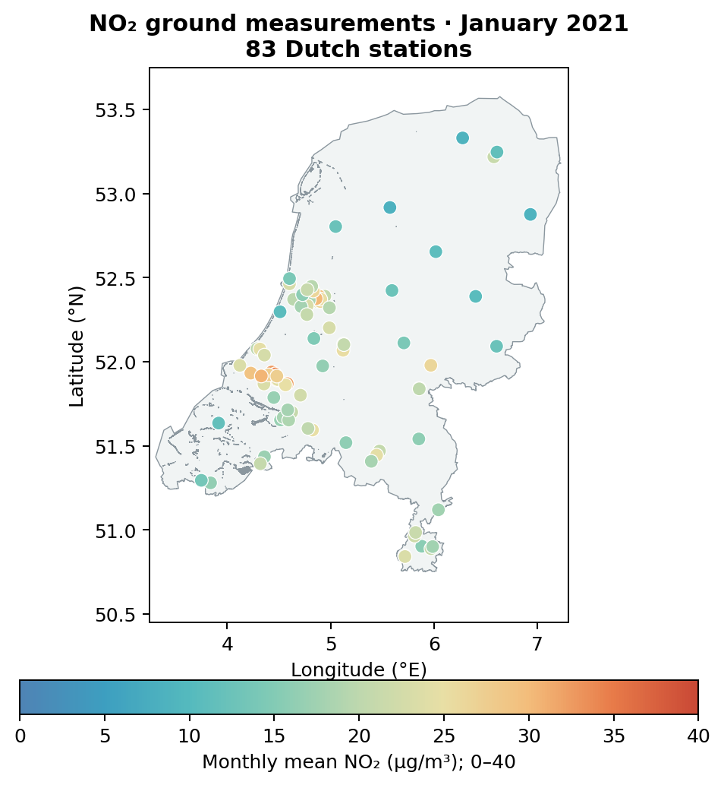 | 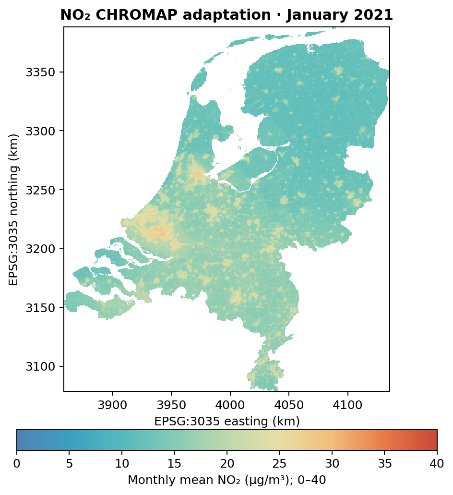 | 3.570 | 83 |
| O₃ | 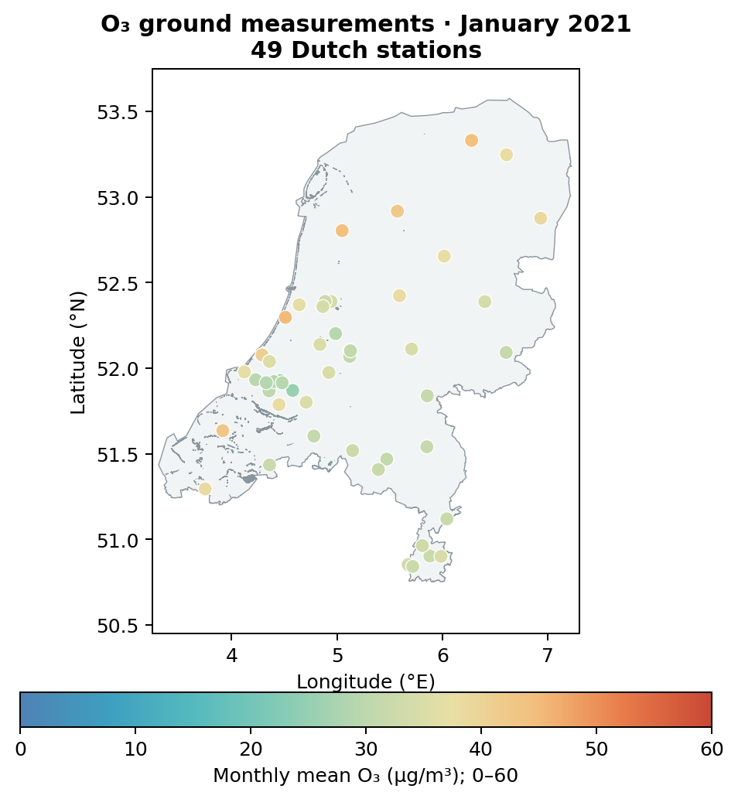 | 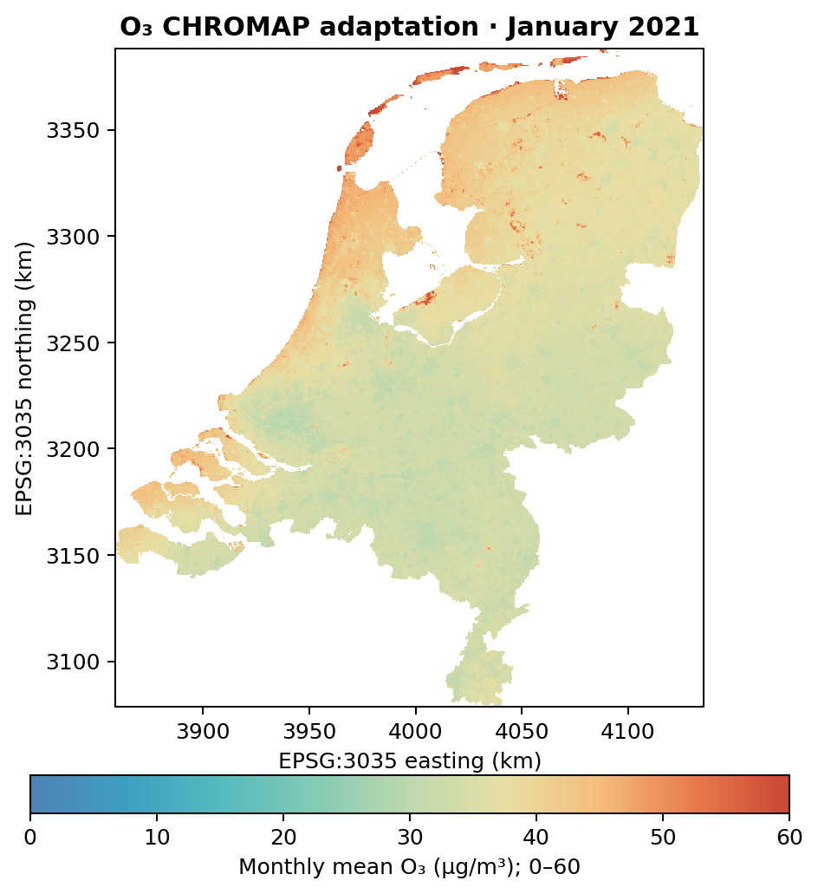 | 2.356 | 49 |
| PM₁₀ | 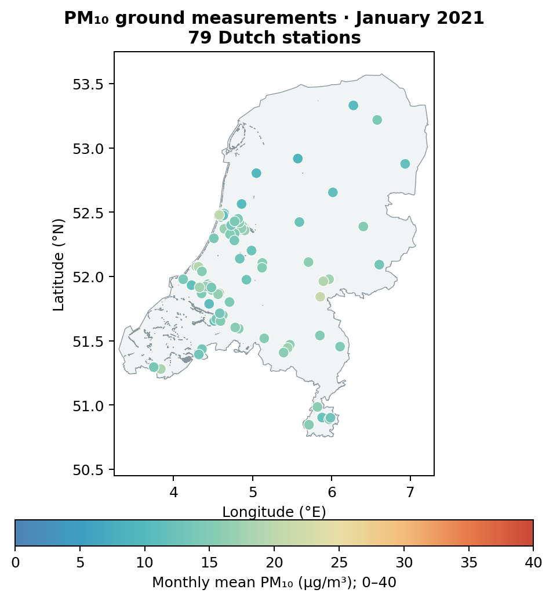 | 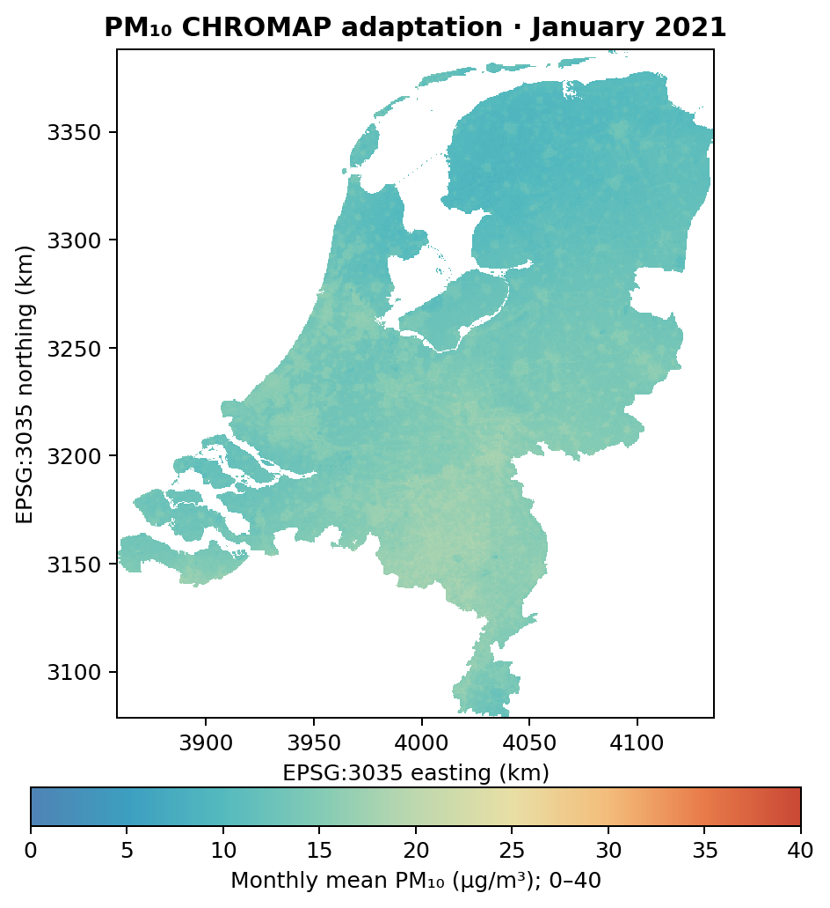 | 2.117 | 79 |
| PM₂.₅ | 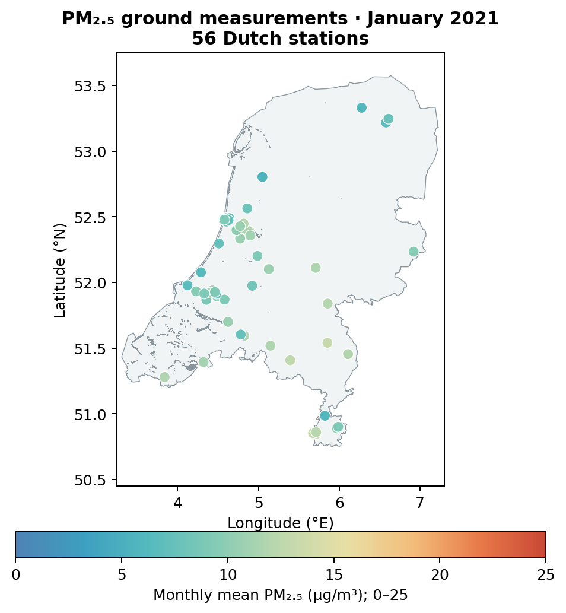 | 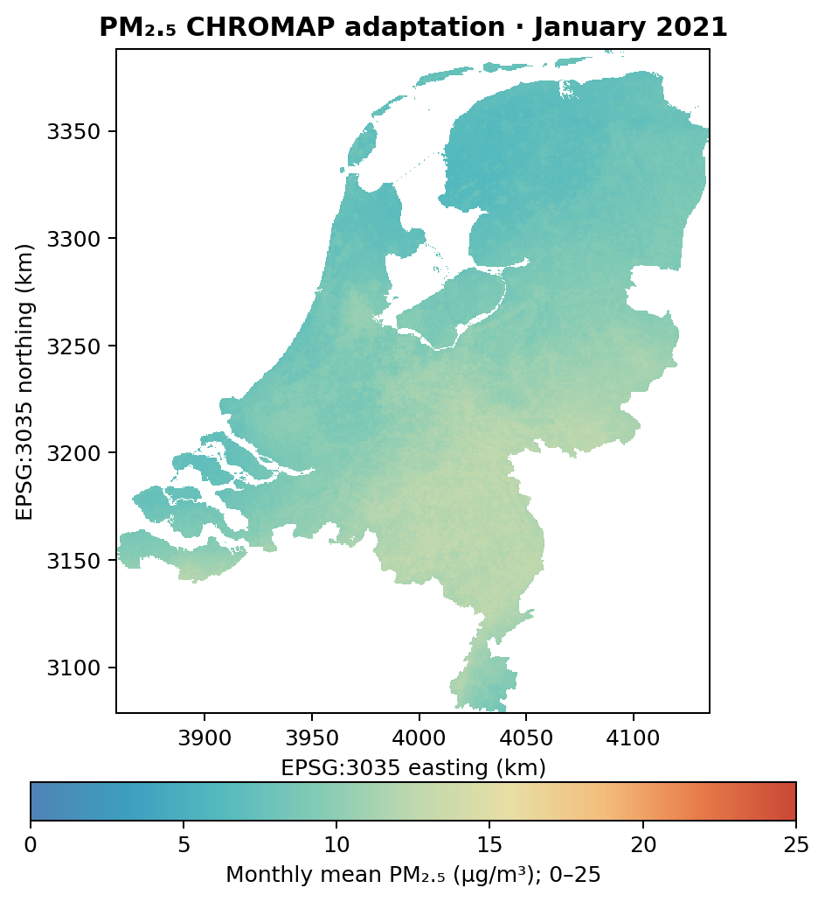 | 1.620 | 56 |
| SO₂ | 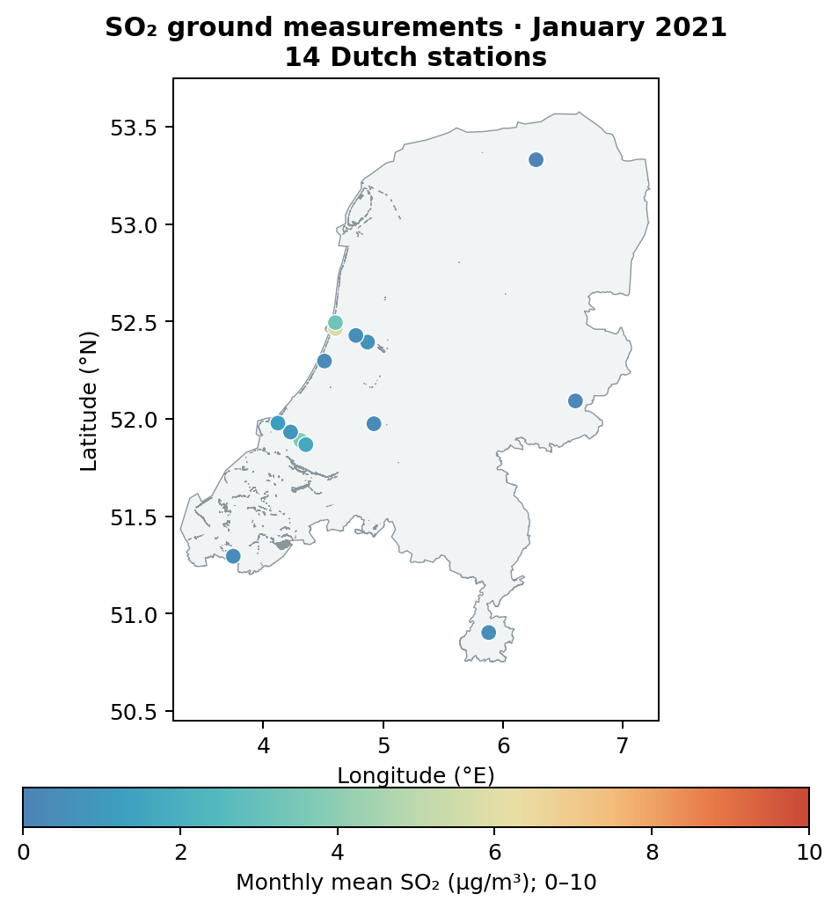 | 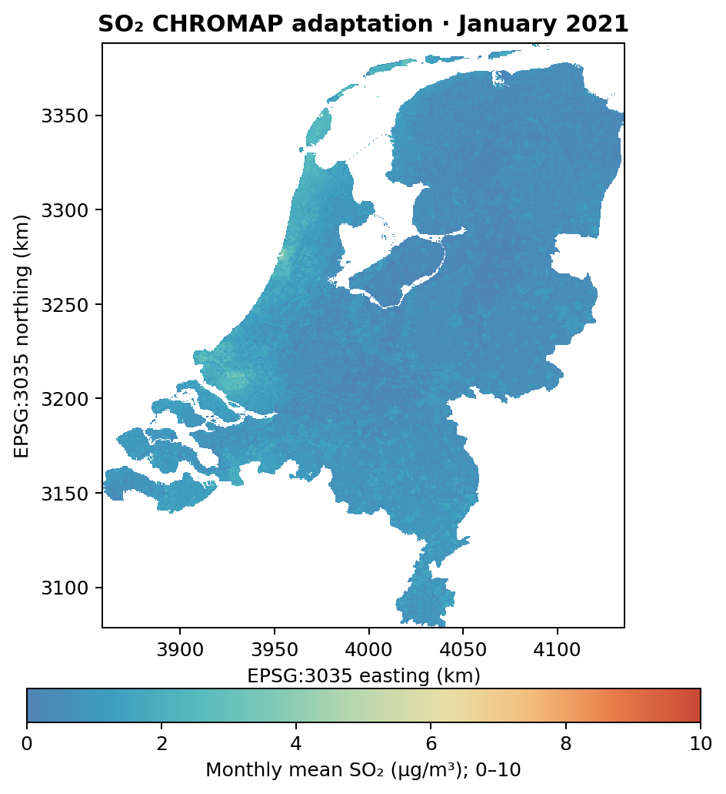 | 1.568 | 14 |

**Held-out means** five geographic station folds were formed separately for
each pollutant. To predict one fold, its stations were excluded from model
fitting; this was repeated until every station had one prediction from a model
that had not seen its measurement. RMSE is the square root of the mean squared
difference between those predictions and observations. This tests spatial
transfer more honestly than comparing training stations with the final map,
but it is *cross-validation*, not a completely separate external test set.
The final map uses all eligible stations, so sampled final-map values are not
independent validation. Fold definitions and performance may change in a new
country or month. See [validation details](docs/VALIDATION_2021_01.md).

## NO₂: CHROMAP versus CAMS

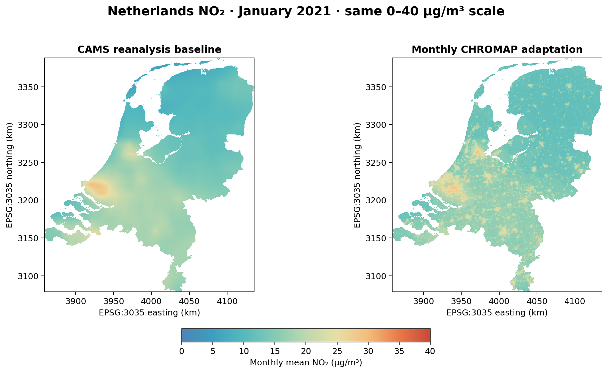

Both panels use the same 0–40 µg/m³ scale and 500 m output grid. CAMS is the
regional chemical-transport reanalysis input; the CHROMAP adaptation uses it
among 22 predictors and adds spatial detail through the trained ensemble.
On Dutch held-out stations, RMSE was **4.120 µg/m³ for CAMS** and **3.570 µg/m³
for CHROMAP** in this January experiment. A visually finer map alone does not
prove better accuracy; the held-out comparison is the relevant check.

## What was adapted

The supplied CHROMAP v1.0 archive provided feature definitions, model code,
pollutant hyperparameters, preprocessing, lower-bound and median-ensemble
procedure—not fitted weights or the original processed training arrays. We
rebuilt predictors and trained new Ridge, Random Forest, XGBoost and MLP
models. The paper describes annual European mapping; this repository trains
independent January 2021 monthly models over a Netherlands-centred domain.
The NO₂ branch uses the documented 22-feature stack. O₃, PM₁₀ and PM₂.₅ use
a project-prepared monthly predictor stack and the supplied pollutant presets.
**SO₂ uses a project-defined preset**, because the supplied archive contained
no SO₂ preset. These four non-NO₂ results are CHROMAP-style adaptations, not
exact reproductions of the paper's feature tables. See the
[method audit](docs/PAPER_FAITHFUL_NO2_2021_01.md).

## Run or adapt

Install Python 3.11+ and the pipeline dependencies:

```powershell
python -m venv .venv
.\.venv\Scripts\Activate.ps1
python -m pip install -e ".[pipeline]"
$env:PYTHONPATH = "src"
python -m unittest discover -s tests -v
```

Raw observations, downloaded predictors and generated NetCDFs are not in Git.
Follow the [runbook](docs/RUNBOOK.md), [data-source register](DATA_SOURCES.md)
and [external adaptation guide](docs/EXTERNAL_ADAPTATION.md). The generic
`scripts/train_monthly_chromap.py` runner takes a station feature table and an
aligned gridded feature NetCDF; it trains the direct ensemble, saves held-out
station predictions and writes the final NetCDF map. Acquisition and feature
construction remain region-specific. Germany therefore requires German data,
a German grid and predictor preparation, retraining and fresh validation.

This is a January 2021 research result, **not** a complete 2013-onward monthly
product. The public figures use a 2026 PDOK boundary as the outline/land mask
for the 2021 experiment; this time mismatch is documented rather than hidden.

## Licence and credit

Original repository code and documentation are [Apache-2.0 licensed](LICENSE).
Source datasets and the original CHROMAP archive retain their own terms and
are not redistributed here. See [acknowledgements](ACKNOWLEDGEMENTS.md),
[source register](DATA_SOURCES.md), and [change log](CHANGELOG.md).
