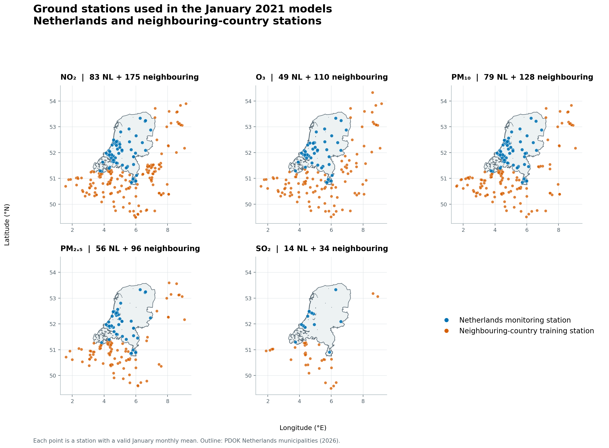

# NL CHROMAP

NL CHROMAP is an independent research adaptation of the [CHROMAP v1.0
methodology](ACKNOWLEDGEMENTS.md) for 500 m monthly air-quality mapping in the
European Netherlands. It contains acquisition and processing scripts, a
Netherlands residual model, a monthly CHROMAP-style comparison, validation
code, and compact results. It is not an official CHROMAP product.

## What is implemented

| Workstream | Available result | Status |
|---|---|---|
| Netherlands pilot | Twelve 2021 monthly maps for NO₂, O₃, PM₁₀, PM₂.₅, and SOMO35 | Local pilot products; SOMO35 belongs to this earlier pilot |
| Paper-feature CHROMAP adaptation | January 2021 NO₂ with the documented 22 predictors and four-model median ensemble | Reconstructed predictors and newly trained models; no author-supplied weights |
| Five-pollutant comparison | January 2021 NO₂, O₃, PM₁₀, PM₂.₅, and SO₂ | Local maps and five-fold geographic validation; SO₂ uses a project-defined model preset because the supplied CHROMAP archive has none |
| Historical production | Monthly maps from 2013 onward | Planned; do not treat the January or 2021 pilots as a complete historical product |

The comparison uses validated RIVM measurements and verified EEA stations in
nearby countries. The maps cover Netherlands land cells only. The fixed
EPSG:3035 grid has 500 m cells and uses the documented 2026 PDOK land boundary
as a static mask, including for the 2021 experiment.

## Methods and evidence

The CHROMAP adaptation predicts concentrations directly with Ridge, Random
Forest, XGBoost, and MLP models, then takes their median. The Netherlands
approach uses CAMS as a baseline and learns a station residual where geographic
validation supports it. Both are evaluated using the same held-out geographic
folds within each pollutant. Final maps are fitted using all eligible stations;
station values sampled from those maps are not independent validation.

| January 2021 pollutant | Stations | CHROMAP held-out RMSE | NL held-out RMSE |
|---|---:|---:|---:|
| NO₂ | 258 | 4.530 | 3.368 |
| O₃ | 159 | 2.892 | 3.135 |
| PM₁₀ | 207 | 2.619 | 2.624 |
| PM₂.₅ | 152 | 1.807 | 1.625 |
| SO₂ | 48 | 1.581 | 1.629 |

RMSE is in µg/m³. The NL method for SO₂ selected unmodified CAMS. The NO₂
CHROMAP result uses the paper-defined feature stack; the other four pollutants
use the project's CHROMAP-style January comparison. See the
[NO₂ method audit](docs/PAPER_FAITHFUL_NO2_2021_01.md),
[NO₂ results](docs/results/NO2_2021_01_PAPER_REPRODUCTION.md), and
[other-pollutant results](docs/results/OTHER_POLLUTANTS_2021_01.md) for
definitions and limitations.



The [Netherlands close-up](docs/results/ground_stations_netherlands_2021_01.png)
shows the station distribution for each pollutant. The figures depict station
locations, not concentration values.

## Start here

Python 3.11 or newer is required. From the repository root:

```powershell
python -m venv .venv
.\.venv\Scripts\Activate.ps1
python -m pip install -e ".[pipeline]"
$env:PYTHONPATH = "src"
python -m unittest discover -s tests -v
```

On Linux or macOS, activate the environment with `source .venv/bin/activate`
and run `PYTHONPATH=src python -m unittest discover -s tests -v`.

The unit tests need no downloaded data. Reproducing a map does: accept each
provider's terms, configure Copernicus CDS access, acquire the source layers,
and build the intermediate files in the expected `data/` layout. Follow the
[runbook](docs/RUNBOOK.md), [source register](DATA_SOURCES.md), and
[external adaptation guide](docs/EXTERNAL_ADAPTATION.md). Several pilot scripts
still use repository-relative paths and specific 2021 filenames; adapting a
new year or region requires editing those paths and rerunning validation.

## Repository layout

```text
config/          documented product settings; not yet consumed by every script
src/chromap_nl/  reusable observation and aggregation logic
scripts/         acquisition, predictors, modelling, validation, export, plots
tests/           core unit tests
docs/            methods, architecture, results, adaptation guide
data/            local raw and processed data; excluded from Git
outputs/         local model products; excluded from Git
output/          local review and station exports; excluded from Git
```

The provided `CHROMAP_v1.0` archive was used as a reference for feature names,
model families, pollutant presets, preprocessing, lower-bound handling, and
median ensembling. It did not include the original processed predictor arrays
or fitted weights, and is not redistributed here. The code in this repository
rebuilds predictors from the cited public products and trains new models.

## Data, licence, and attribution

The repository contains code, documentation, and compact figures and metrics.
Downloaded archives, station-level source data, credentials, model objects,
and generated NetCDF products stay local. Data providers set their own licences
and access conditions; the repository's software licence does not override
them. See [data handling](data/README.md) and the [source register](DATA_SOURCES.md).

Repository code and original documentation are licensed under
[Apache-2.0](LICENSE). CHROMAP's original methodology and authors are credited
in [ACKNOWLEDGEMENTS.md](ACKNOWLEDGEMENTS.md); the upstream archive and source
datasets retain their own terms. Changes to this adaptation are recorded in
[CHANGELOG.md](CHANGELOG.md).
