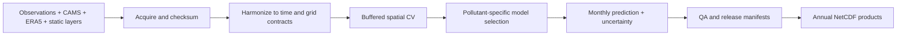

# NL CHROMAP

NL CHROMAP is a reproducible pipeline for monthly 500 m air-quality maps over the
European Netherlands. It covers January 2013 through December 2025 and produces
NO2, PM2.5, PM10, O3 monthly means plus monthly SOMO35 contributions. The 2021
end-to-end pilot is complete; full-period production is the next release phase.

The project uses a fixed EPSG:3035 land grid with 140,260 cells, cross-border
station training within a 150 km buffer, CAMS reanalysis as the baseline, and
buffered spatial cross-validation for residual downscaling.

> This is a private research repository. It contains code, configuration,
> methodology, tests, and compact results—not provider downloads or generated
> raster/NetCDF products.

## 2021 pilot result

The pilot harmonized 12,795 station-month-indicator records from 334 RIVM and EEA
stations and generated all twelve monthly five-indicator maps with uncertainty
proxies.

| Indicator | CAMS RMSE | Extra Trees RMSE | Selected production candidate |
|---|---:|---:|---|
| NO2 | 7.27 | 4.73 | Extra Trees residual correction |
| O3 | 4.13 | — | CAMS baseline |
| PM10 | 3.37 | 3.11 | Extra Trees residual correction |
| PM2.5 | 1.62 | — | CAMS baseline |
| SOMO35 | 59.69 | — | CAMS baseline |

Candidate correction is retained only when it improves spatial CV. Full detail is
in [`PILOT_2021_RESULTS.md`](PILOT_2021_RESULTS.md) and the machine-readable metrics
are in [`docs/results/spatial_cv_metrics_2021.csv`](docs/results/spatial_cv_metrics_2021.csv).

## Architecture



See [`docs/ARCHITECTURE.md`](docs/ARCHITECTURE.md) for data-flow, component, and
release-sequence diagrams.

## Quick start

```powershell
python -m venv .venv
.\\.venv\\Scripts\\Activate.ps1
python -m pip install --upgrade pip
python -m pip install -e ".[pipeline]"
$env:PYTHONPATH = "src"
python -m unittest discover -s tests -v
```

Acquisition requires provider licence acceptance and, for Copernicus products, a
configured CDS API account. Follow [`docs/RUNBOOK.md`](docs/RUNBOOK.md) for the
ordered workflow and [`DATA_SOURCES.md`](DATA_SOURCES.md) for provenance and
licensing notes.

## Repository layout

```text
config/                 versioned product and methodology settings
src/chromap_nl/         reusable target and ingestion logic
scripts/                acquisition, processing, modelling, QA, packaging
tests/                  unit tests for core data contracts
docs/                   architecture, runbook, roadmap, compact results
data/                   local-only raw and processed workspace
outputs/                local-only generated products
```

## Reproducibility and data policy

Raw archives, provider files, aligned rasters, models, and generated NetCDF/PNG
artifacts total more than 60 GB locally and are intentionally excluded from Git.
They may also carry provider-specific redistribution terms. Acquisition scripts,
source documentation, configuration, manifests produced by the pipeline, and
checksums provide the reproducibility trail. Publish release artifacts separately
with immutable checksums and provenance.

The reference CHROMAP v1.0 archive was reviewed but is not run unmodified; known
issues and redevelopment decisions are recorded in
[`REFERENCE_IMPLEMENTATION_REVIEW.md`](REFERENCE_IMPLEMENTATION_REVIEW.md).

## Scope and release status

- Territory: European Netherlands; Dutch Caribbean and sea cells excluded.
- Resolution/CRS: 500 m, EPSG:3035.
- Period: 2013–2025; validated releases through 2024, with 2025 provisional.
- Aggregation: UTC, explicit daily/monthly completeness rules in
  [`config/product.yml`](config/product.yml).
- SOMO35: monthly sum of daily maximum 8-hour O3 means above 70 µg/m³, with
  cross-month windows handled explicitly.

The production plan and release gates are in [`docs/ROADMAP.md`](docs/ROADMAP.md).
No open-source licence is granted while this repository remains private.
