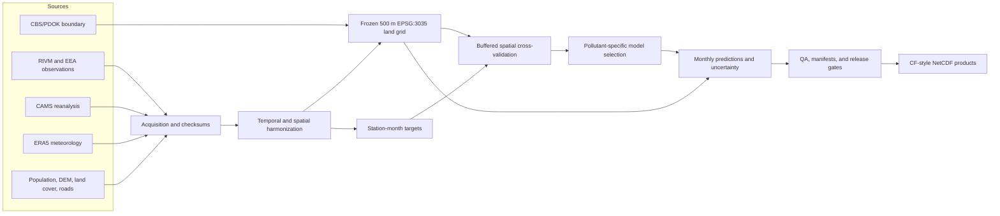
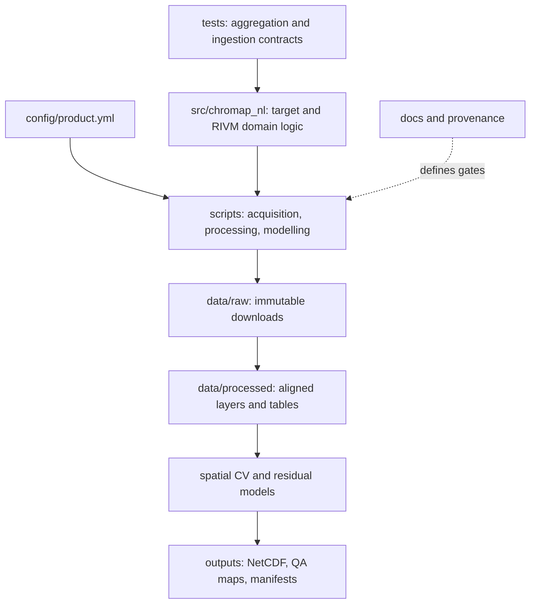
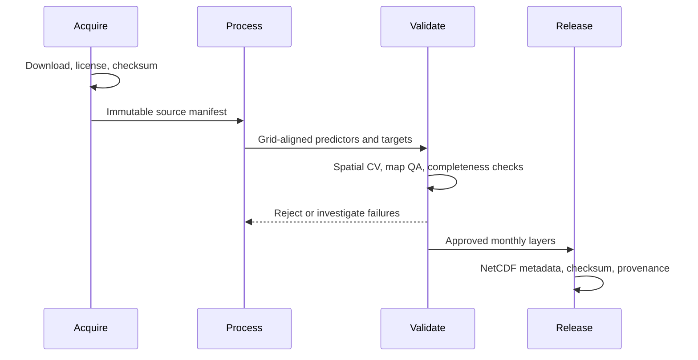

# Architecture

NL CHROMAP is a file-oriented, reproducible geospatial pipeline. The frozen grid,
target rules, model selection protocol, and output schema remain constant across
years so monthly products are comparable.

## Data flow

## Software components

## Modelling contract

For each pollutant, CAMS is the baseline. Candidate Extra Trees models learn the
station residual after static and meteorological predictors are aligned. Models
are selected only when buffered spatial cross-validation improves RMSE; otherwise
the CAMS baseline is retained. The 2021 pilot selected residual correction for
NO2 and PM10, and CAMS for O3, PM2.5, and SOMO35.

## Release boundary

