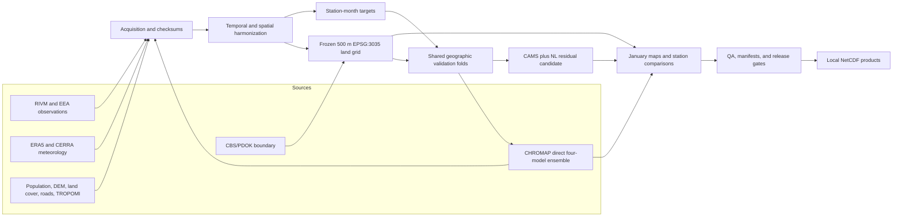
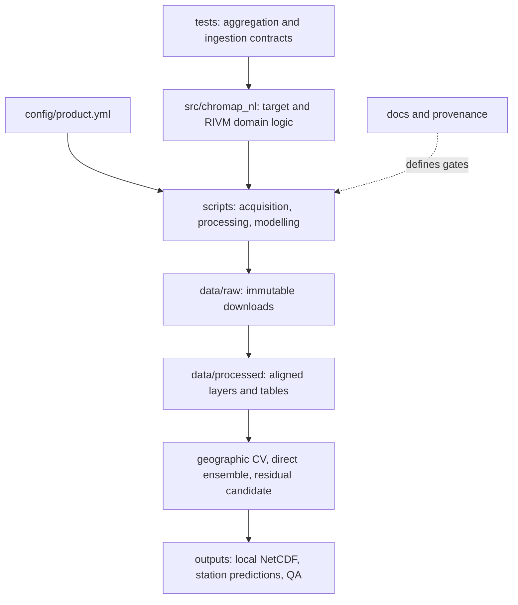
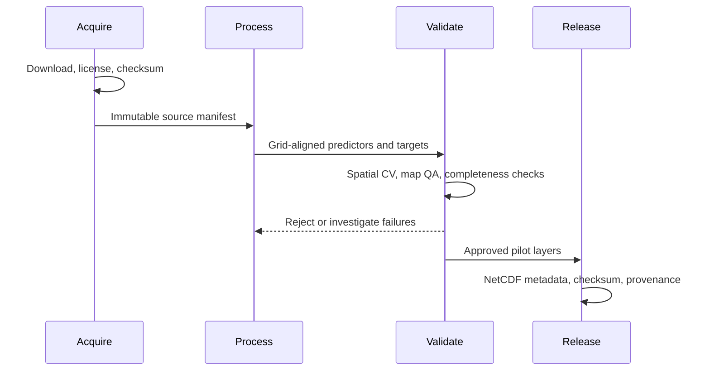

# Architecture

NL CHROMAP is a file-oriented geospatial research pipeline. The January 2021
comparison shares a fixed grid, station targets, and geographic validation
folds. Historical production will require an explicit decision about monthly
versus pooled training and consistent predictor availability across years.

## Data flow

## Software components

## Modelling contract

The original 2021 Netherlands pilot used CAMS as a baseline and selected an
Extra Trees residual correction only when spatial validation improved RMSE.
It selected corrections for NO2 and PM10, and CAMS for O3, PM2.5, and SOMO35.

The January 2021 five-pollutant experiment also trains a CHROMAP-style direct
ensemble of Ridge, Random Forest, XGBoost, and MLP. The NO2 branch reconstructs
the documented 22-feature stack; the other pollutants use the pilot-oriented
feature stack. SO2 has a project-defined preset because the supplied CHROMAP
archive contains no SO2 preset. All comparisons report held-out predictions
from the same five geographic folds within each pollutant. Final maps are
trained using all eligible stations and are not independent validation.

## Release boundary

