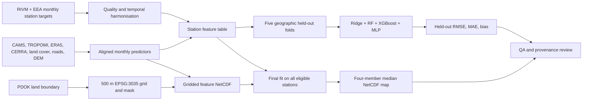

# Architecture

The `main` branch is a file-oriented monthly **direct CHROMAP ensemble**
adaptation. The January 2021 result is a research pilot, not a production
time series. A different Netherlands residual experiment is retained only on
the `nl-residual-comparison` branch.

`scripts/train_monthly_chromap.py` implements the direct ensemble and spatial
validation after input preparation. `scripts/chromap_models.py` records the
fixed pollutant presets; the SO₂ preset is a project extension. The NO₂ input
branch uses the 22 documented paper predictors. The four other pollutants
use a monthly pilot predictor stack. `src/chromap_nl/` contains reusable
monitoring-target logic; `scripts/` contains source acquisition, raster
preparation and modelling tasks.

The final map's station overlay is not validation because its fit used those
stations. Only the out-of-fold predictions support the reported held-out
scores. Raw inputs and generated NetCDFs remain local and are not committed.
