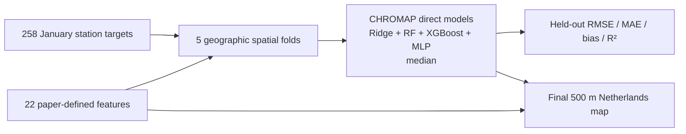

# Paper-faithful CHROMAP NO₂ experiment — January 2021

This experiment is an independent monthly adaptation of CHROMAP v1.0 by Guion
et al., not an official CHROMAP product. Full attribution and the recommended
citation are provided in [the repository acknowledgements](../ACKNOWLEDGEMENTS.md).

## What “reproduction” means here

The publication describes annual European maps averaged over 2019–2023. This
experiment instead answers the requested January 2021 Netherlands question. It
reproduces the documented NO₂ feature definitions, preprocessing, four model
families, fixed NO₂ hyperparameters, lower-bound rule, and median ensemble, but
changes the temporal aggregation from annual to monthly. It is therefore a
**paper-faithful monthly adaptation**, not a byte-for-byte reproduction of the
published annual raster.



## NO₂ predictor stack

| Group | Paper feature(s) | Source used | January treatment |
|---|---|---|---|
| Target | Ground-level NO₂ | RIVM hourly observations and EEA E1a validated measurements | Monthly mean with the project completeness rule; 258 stations |
| Chemistry | `CHEM_CTM_no2` | CAMS European air-quality validated reanalysis, median ensemble | Mean of January 2021 hourly fields |
| Chemistry | `CHEM_Sat_no2` | Sentinel-5P/TROPOMI RPRO processor 02.04.00 total vertical NO₂ column | QA > 0.75; January 2021 mean |
| ERA5 | `MET_Precip`, `MET_Rad`, `MET_Pbl` | ERA5 monthly means | January 2021 |
| CERRA | `MET_Winds`, `MET_Temp`, `MET_SurfP`, `MET_CloudC` | CERRA 3-hourly analysis | Mean of all 248 January analysis times |
| Land cover | crop, tree, grass, built-up, shrub, bare fractions | Copernicus Global Land Cover v3, 2018, 100 m | Area aggregation to 500 m |
| Population | `GEO_PopDens` | GHS-POP R2023A, epoch 2020, 100 m | Sum to 500 m |
| Urban degree | `GEO_UrbDeg` | GHS-SMOD R2023A, epoch 2020, 1 km | Nearest neighbour |
| Roads | `GEO_RoadNet` | OpenStreetMap/Geofabrik; motorway, trunk, primary, secondary | Approximate centreline length per 500 m cell |
| Terrain/location | latitude, longitude, altitude, coast distance | Calculated coordinates, Copernicus DEM, Natural Earth coast | Static |

## Monthly ensemble

1. **Paper-feature CHROMAP:** standardized/imputed inputs; direct Ridge,
   Random Forest, XGBoost, and MLP predictions; each prediction is bounded below
   by the training-target minimum; output is the four-member median.
The five geographic K-means folds contain 258 stations in total, of which 83
are Dutch. Preprocessing and fitting occur inside each fold. The final map is
refitted with every eligible station. CAMS is a chemical predictor and is
shown separately as a baseline; it is not a second correction model.

## Known differences from the publication

| Item | Publication | This experiment | Consequence |
|---|---|---|---|
| Time | Annual, 2019–2023 average | January 2021 | Required adaptation; results cannot equal the paper map |
| Domain/training | Europe-wide | Netherlands plus nearby-country stations | Smaller training geography |
| Elevation | Copernicus DEM GLO-90 | Available GLO-30 aggregated to 500 m | Same DEM family, different native resolution |
| Roads | OSM source documented in the paper workflow | Current 2026 Geofabrik snapshot | Road epoch differs from the paper run |
| Coast | Calculated distance | Natural Earth 1:10m land boundary | Coastline implementation may differ |
| Author artefacts | Predictor arrays and trained weights not released | Rebuilt from cited public products | Exact published pixels cannot be reconstructed from code alone |

## Reproduce

After accepting the Copernicus licences and configuring CDS credentials:

```powershell
python scripts/download_cerra_month.py --year 2021 --month 1
python scripts/build_tropomi_no2_month.py --year 2021 --month 1 --workers 4
python scripts/build_chromap_static_buffer.py
python scripts/build_paper_no2_features_2021_01.py
python scripts/train_monthly_chromap.py --pollutant no2 --feature-set paper-no2 --month 2021-01 --stations data/processed/model/paper_no2_2021_01/paper_no2_station_features_2021_01.csv.gz --grid-features data/processed/model/paper_no2_2021_01/paper_no2_grid_features_2021_01.nc --grid-mask data/processed/grid/chromap_nl_500m_grid.nc --output-dir outputs/chromap_no2_2021_01
```

Generated-data manifests include SHA-256 hashes. Raw and generated bulk data are
excluded from Git; scripts, metrics, documentation, and figures are versioned.
