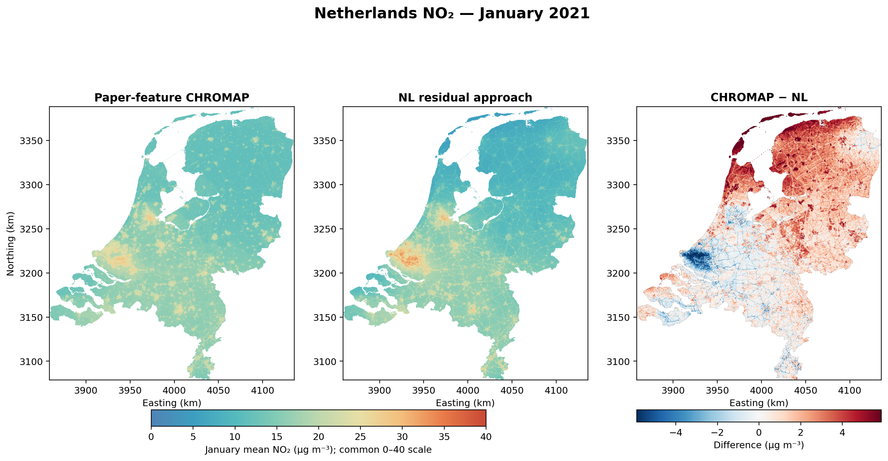
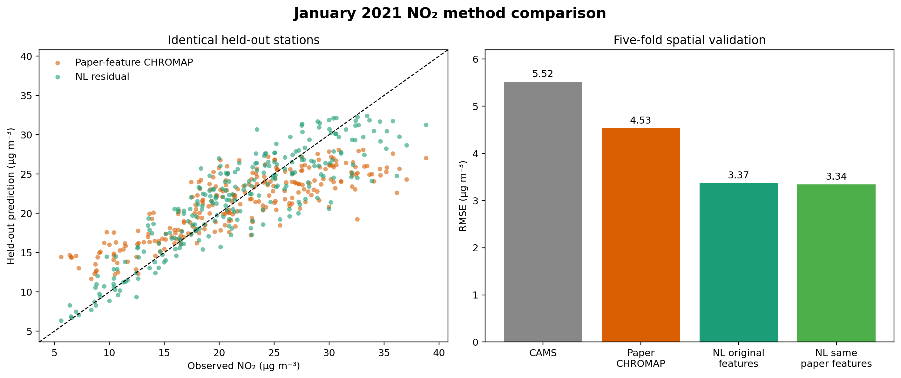
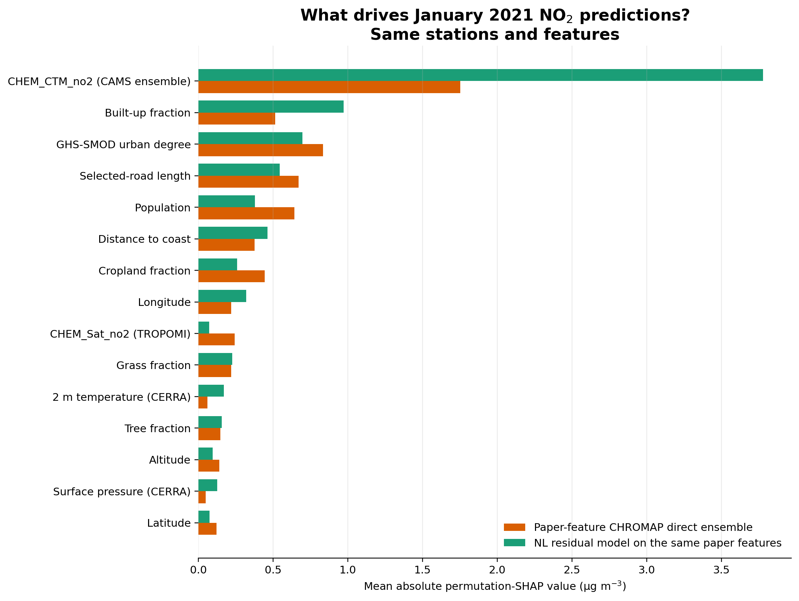

# January 2021 NO₂: paper-feature CHROMAP versus NL

## Result

| Method | RMSE | MAE | Bias | R² |
|---|---:|---:|---:|---:|
| CAMS baseline | 5.518 | 4.039 | -2.524 | 0.430 |
| Paper-feature CHROMAP | 4.530 | 3.618 | -0.544 | 0.616 |
| NL residual, original features | 3.368 | 2.598 | -0.083 | 0.788 |
| NL residual, same paper features | 3.344 | 2.542 | 0.021 | 0.791 |

The paired bootstrap difference (paper CHROMAP minus NL-original RMSE) is
1.163 µg m⁻³, with descriptive 95% interval
[0.836, 1.479]. Positive values favor NL.

The controlled same-feature comparison (4.530 versus 3.344 RMSE) indicates that
the residual formulation—not the NL feature substitutions—accounts for most of
the improvement in this experiment.

## Leading SHAP drivers

### Paper-feature CHROMAP

| Rank | Feature | mean abs. SHAP | share |
|---:|---|---:|---:|
| 1 | `CHEM_CTM_no2` | 1.752 | 25.4% |
| 2 | `GEO_UrbDeg` | 0.835 | 12.1% |
| 3 | `GEO_RoadNet` | 0.671 | 9.7% |
| 4 | `GEO_PopDens` | 0.643 | 9.3% |
| 5 | `GEO_Builtup` | 0.514 | 7.4% |
| 6 | `GEO_Crop` | 0.445 | 6.4% |
| 7 | `GEO_DistCoast` | 0.378 | 5.5% |
| 8 | `CHEM_Sat_no2` | 0.243 | 3.5% |

### NL residual on the same paper features

| Rank | Feature | mean abs. SHAP | share |
|---:|---|---:|---:|
| 1 | `CHEM_CTM_no2` | 3.779 | 43.0% |
| 2 | `GEO_Builtup` | 0.972 | 11.1% |
| 3 | `GEO_UrbDeg` | 0.696 | 7.9% |
| 4 | `GEO_RoadNet` | 0.545 | 6.2% |
| 5 | `GEO_DistCoast` | 0.462 | 5.3% |
| 6 | `GEO_PopDens` | 0.379 | 4.3% |
| 7 | `GEO_Lon` | 0.321 | 3.7% |
| 8 | `GEO_Crop` | 0.260 | 3.0% |

The paper's three highlighted variables are now real inputs: `CHEM_CTM_no2`
ranks 1st, `GEO_UrbDeg` 2nd, and `CHEM_Sat_no2` 8th in the January CHROMAP
adaptation. A different rank from the publication is expected because its figure
averages annual models over 2019–2023 across Europe, whereas this run uses one
winter month and a Netherlands-centred station sample.

## Interpretation limits

- This is a paper-faithful **monthly adaptation**, not the published annual map.
- The original predictor arrays/trained weights are not released.
- The CHROMAP MLP hit its 200-iteration limit in all five folds, matching the
  supplied implementation limit but adding model instability.
- One TROPOMI archive object is internally truncated; 70 intersecting orbits and
  202,617 QA-valid pixels were retained, with the failure recorded in the manifest.
- SHAP values explain fitted predictions and are not causal effects.
